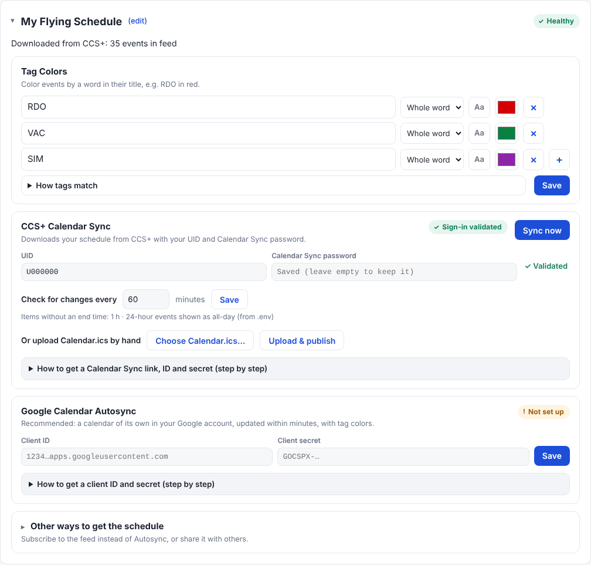
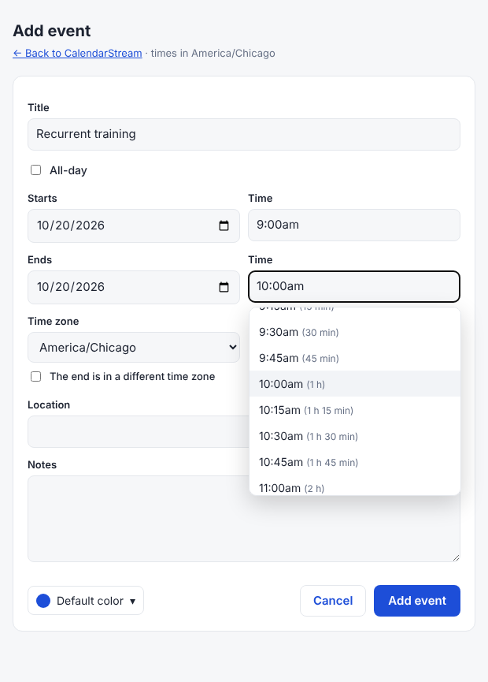
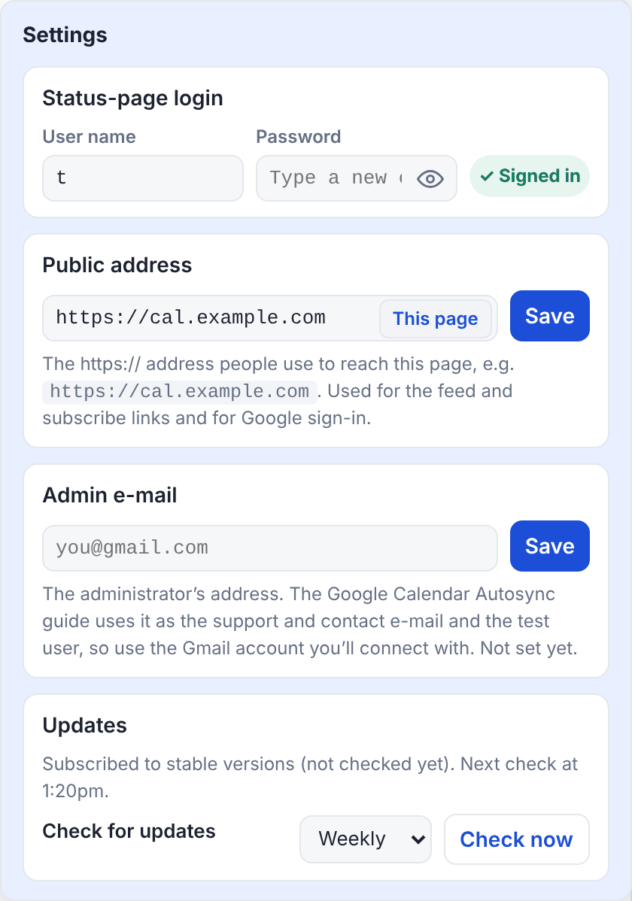

# CalendarStream

Maintains a Google Calendar in sync with your United Airlines CCS+ schedule.

United Airlines' CCS+ does not provide a method to keep your Google Calendar up to date
automatically. United instead offers an official **Calendar Sync** download (`Calendar.ics`),
protected by your UID and a Calendar Sync password, which must be downloaded and re-imported into
Google Calendar by hand.

CalendarStream automates this process by downloading the official `.ics` file on a timer and
either:

1. writes it into a Google calendar of its own (updated within minutes, with rule colors), or
2. republishes it as a feed that Google, Apple Calendar and others can subscribe to.

Other calendars can be added the same way: any `.ics` / `webcal://` feed (another airline, work,
school, sports) becomes a source. Destinations (Google calendars and feed links, as many as you
like) each pick which sources they get. A status page shows them all, lets you edit events, color
or add events with rules, and walks you through setup.

<p align="center">
  <picture>
    <source media="(prefers-color-scheme: dark)" srcset="docs/screenshots/calendar-dark.png">
    
  </picture>
</p>

<details>
<summary>More screenshots: setup, adding an event, Settings</summary>
<p align="center">
  <br><br>
  
  
</p>
<sub>Made-up demo schedule.</sub>
</details>

## Quick start

On any computer with Docker (Linux, macOS with Docker Desktop, or Windows in a WSL terminal), run the
installer below. For Google Calendar **Autosync** you also need a web address with your own domain
name, reached over `https://` (through a reverse proxy or a tunnel to this computer); without one,
use the feed instead.

```bash
bash <(curl -fsSL https://raw.githubusercontent.com/Uuugh/CalendarStream/main/install.sh)
```

[`install.sh`](install.sh) asks three questions (press Enter for the default):

1. which release to install, `latest` (stable) or `beta` (`stable`);
2. the folder for `docker-compose.yml` and `.env` (`~/stacks/calendarstream`);
3. the folder for CalendarStream's config and data, the database and `.secrets/` (the same folder).

It then downloads `docker-compose.yml` and `.env`, creates a random database password, starts
CalendarStream and prints its address and a **setup code**. Running it again updates
CalendarStream: the defaults are then your current settings, and your `.env` (apart from those
answers) and the database password are kept.

Then open the address it printed:

1. **Create your login** with the setup code.
2. **Calendar Sources → +** → **United CCS+ Calendar Sync**, then enter your CCS+ UID and Calendar
   Sync password. (Or add any calendar feed.)
3. **Calendar Destinations → +**: it first asks for the public `https://` address; check the
   spelling, because Google sends you back to exactly this address. Name the destination, then add:
   - a **Google calendar** (recommended): in the **Google account** box, follow the step-by-step
     guide in order. Publish the app, or add yourself as a test user, **before** pressing Connect; or
   - a **Calendar feed**, and press **Add to Google Calendar** to subscribe to it instead.

## Settings

Everything is optional. Most settings are made on the status page; `.env` holds the rest, each
explained in [`.env.default`](.env.default):

| Setting | Default | Notes |
|---|---|---|
| `MNT_DOCKER` | the stack folder | Where the database (`calendar_stream/postgres`) and `.secrets/` live; the installer asks |
| `TZ` | `America/Chicago` | Time zone the schedule is shown in |
| `IMAGE_TAG` | `latest` | `latest` (stable), `beta` (newest) or a version, e.g. `0.2.7` or `0.2.7-beta.1`; the installer asks |
| `PUID` / `GUID`, `RESTART` | `1000` / `100`, `unless-stopped` | |
| `FORWARDED_ALLOW_IPS` | `127.0.0.1` | Behind a reverse proxy: its address or network (e.g. `172.18.0.0/16`), so visitors' addresses and https are seen |
| `SYNC_INTERVAL_MINUTES` | `60` | 15–1,440, for CCS+; overridden by “Check for changes every” in its box |
| `CCS_CALENDAR_URL`, `CALENDAR_NAME` | United's link, "United CCS Schedule" | Overridden in the CCS+ box (Configure) |
| `DEFAULT_EVENT_HOURS` | `1` | Hours for items with no end time, or `allday`; a source's Items-without-an-end-time rule overrides it |
| `ALLDAY_24H` | `true` | Show 24-hour (48 h…) events as all-day; replaced by each source's 24-hour-events rule |
| `FEED_TOKEN` | made once | The stream name of the feed made when upgrading from before 0.2.1; feeds' stream names are set on the status page |

**Secrets.** The only file is `.secrets/DB_PASSWORD.txt`, made by the installer. The status-page
login (hashed), the CCS+ password, and the Google client secret and sign-in (encrypted) are kept in
the database. The encryption key comes from `DB_PASSWORD`, so a copy of the database alone reveals
nothing; keep that file and don't change it (if you do, re-enter those passwords). Five wrong
logins or setup codes lock an address out for 15 minutes.

## How syncing works

- CalendarStream downloads the Calendar Sync link with `curl` (it identifies itself honestly;
  United's bot protection holds Python's HTTP clients) and only fetches it again when it changed.
- Events keep United's IDs, times and details, except: day codes (RDO, HDO…) and other items with no
  end become all-day or `DEFAULT_EVENT_HOURS` long, and 24-hour events (CCS+ writes full days as
  00:01–23:59:59) become all-day with the original times in the notes.
- A failed download or a suddenly empty calendar keeps the previous schedule.
- If the download is blocked, open the Calendar Sync link in a browser and use **Upload & publish**
  in the CCS+ Calendar Sync box.
- **Sign-in rejected** means CCS+ refused the UID or password; after two rejections, automatic
  checks pause so your account isn't locked (press **Sync now** after fixing them).

## The status page

- **Calendar:** every source's events. On the right: the time zone it's shown in (on this page only;
  the feeds and Google keep `TZ`), **Month / Week / Day / List**, and the **12h / 24h** switch. Click
  the title to jump to any month. Click an event to see it, **Edit** it (title, times, notes, or
  hide it), **duplicate** it or **delete** it (a source's own event is hidden instead, since the
  source would send it again); clicking elsewhere closes it, and its 📌 pin keeps it open.
  Click an empty spot on a day (or **+**) to add your own. Events can have their own color (one of
  Google's 11), which wins over rules. Edits survive new downloads; ✎ marks
  an edited event, ⚠ one its source changed since. Nothing is ever changed in CCS+.
- The page's sections: **Calendar** at the top, then **Calendar Sources**, **Calendar
  Destinations**, **Rules** and **Activity**, each with the same kind of heading. On a wide screen
  they sit in two columns (Sources | Destinations, Rules | Activity); on a narrow screen or a phone
  they're one column, the calendar opens on the List view, and the view and theme switches become
  one button each that steps through the choices.
- **Calendar Sources** (**+** adds one; a new install has none): **United CCS+ Calendar Sync**
  (once) and **calendar feeds** (any link starting with `webcal://` or ending in `.ics`, with a
  title and an optional short note shown next to it; repeating events are shown from a year back to
  two years ahead). Each source's box shows its color, title and note, the last download
  ("Downloaded 98 events from feed @ 23:13 (0 new, 0 removed)"), the check interval, its status
  and **Sync Now**. **▸ Configure ◂** opens the rest (it opens by itself when something needs
  doing) and turns the color, title and note into fields: the **Site Address** (the Calendar Sync
  link, or the feed's link) with CCS+'s UID and password (**✓ Validated** until you type; then
  **Save** / **Cancel**, and Save shows Saved → Verifying… → ✓ Validated or ✗ Verification failed),
  step-by-step help, CCS+'s hand upload, and its **Rules**: one rounded line per rule, each picked
  from the Rules section's list (or **Create a New Rule…**, which opens the same dialog as there).
  The bin removes a rule from the source, or the source itself.
- **Calendar Destinations** (**+** adds one; the first asks for the public address), independent of
  the sources: **Google calendars** (Autosync; one **Google account** box signs in for all of them)
  and **Calendar feeds** (a feed link and a shareable subscribe page each), as many as you like.
  Each has its own name, a **Start** and **End** date (empty = no limit) and ticks the sources it
  gets; every event keeps its source's colors and rules. Each feed has a **stream name**, the secret
  part of its links: after a reinstall, or removing a feed by mistake, enter the old one (or paste
  an old link) and existing subscriptions work again.
- **Rules:** every rule, kept once and used by any source (each shows which sources use it; **+**
  or ✎ opens the rule dialog). Kinds:
  - **Color:** match a title (whole word, contains, starts with or exact title) and color the event
    (e.g. RDO in red).
  - **Add event:** match a title and add an event from an event template some time before the
    start, after the start or after the end (e.g. a 1:30 drive to the airport 2:00 before each trip).
  - **Items without an end time** (predefined): how long they last, or all day.
  - **24-hour events** (predefined): show them (CCS+ writes full days as 00:01–23:59:59) as all-day,
    with the original times in the notes.

  New sources start with the two predefined rules; a source without them uses
  `DEFAULT_EVENT_HOURS` and keeps 24-hour events as they are. **Event templates** (inside Rules) are
  ready-made events (title, length or all day, location, color) for Add-event rules and for **Start
  from a template** when adding an event by hand.
- **Activity log:** each check and what changed, for each source.
- **☰ Settings:** site settings only: the status-page login (with a show-password eye and a
  strength bar, like every password box), the public address, the **admin e-mail** (filled into the
  Google setup guide) and **Check for updates** (hourly, weekly, monthly or never; only versions of
  your release, stable or beta, are offered, and a newer one shows next to the version at the top).
- **Report a problem / Suggest a feature** at the bottom of the page open a GitHub issue form.
- **Language** (🌐, left of the Light / Dark / System theme switch): English, Español, Français,
  Deutsch, Português and Vlaams, or Automatic (the browser's language). Everything on the page is
  translated, including status messages and the activity log; event titles stay as United sends
  them. The shareable subscribe page uses each visitor's browser language.
- `GET /api/status` and `GET /healthz` for monitoring.

## Syncing straight to Google Calendar

CalendarStream writes each Google destination into a calendar it creates in your Google account,
with the events of the sources it ticks. It only asks
for access to **calendars it created** and your e-mail address, so it can't see your other calendars.

- Events within the destination's Start and End dates (all of them when empty), with your edits,
  without reminders; CCS+'s "free" items stay free. Events before the Start are left alone.
- Each event gets the nearest Google event color (Tomato, Basil, Peacock…) to its own color, its
  source's color rule or its source's color; each calendar's name follows its destination's.
  Removing a destination leaves its calendar in Google unless you tick "Also delete it in Google".
- Changes reach Google within seconds. A daily check (or **Sync now**) puts back events changed or
  deleted in Google and makes a new calendar if it was deleted.
- **Instant updates from Google:** with a public `https://` address, CalendarStream asks Google to
  notify it (a webhook to `/google/notify`) whenever one of its calendars changes there, and puts back
  hand edits within seconds instead of at the daily check. Nothing to set up; it needs a valid
  certificate, and your proxy must let Google's POSTs to `/google/notify` through without a login.
  Without it, the daily check carries on as before.

**Setup:** the Google Calendar Autosync box has a step-by-step guide to creating a free OAuth client in Google
Cloud. Paste its client ID and secret (checked with Google straight away), then **Connect**. Google
warns it "hasn't verified this app" because it's your own: press **Continue** (or **Advanced → Go to
CalendarStream**), tick the calendar box and press **Continue**. The guide ends with a list of
Google's error messages and what to do about each.
One client serves the whole install, for up to 100 people while unverified. If you also subscribed
to a feed in Google, remove that calendar, or you'll see everything twice.

**Feeds on Android:** Google's Android app can't add a calendar by link, and a calendar added by
link on calendar.google.com stays hidden on the phone until it's turned on there: in the app,
**Settings →** the calendar **→ Sync**. The subscribe page explains this on Android and iPhone.

## Versions and releases

Versions follow [semver](https://semver.org): `x.y.z` for a stable release, and `x.y.z-beta.N` for
the betas leading up to it (0.2.7-beta.1, 0.2.7-beta.2, … then 0.2.7). Each version has a git tag,
a GitHub Release with its [`CHANGELOG.md`](CHANGELOG.md) notes, and an image
`ghcr.io/uuugh/calendarstream:<version>`. `beta` is the newest version; `latest` is the last stable
one (the `STABLE` file). The **Release** GitHub Action builds a version when `VERSION` changes and
moves `latest` when `STABLE` changes (or from **Actions → Release → Run workflow**). A stable
install is only told about stable releases; a beta install about every newer version.

## Data and backups

Everything is in the Postgres container `calendar_stream_db` (files in
`$MNT_DOCKER/calendar_stream/postgres`); the app container keeps nothing. Tables are created
automatically.

```bash
docker exec calendar_stream_db pg_dump -U ccs calendar_stream > calendar_stream.sql   # backup
docker exec -it calendar_stream_db psql -U ccs calendar_stream                         # look inside
```

**Starting over:** `docker compose down`, then delete `calendar_stream/postgres`. This erases
everything: sources, destinations, edits, rules, templates, settings, logins, the Google connection and the feed links.

## License

CalendarStream is free for **non-commercial use** under the
[PolyForm Noncommercial License 1.0.0](LICENSE.md): you may use, change and share it for any
non-commercial purpose, but not sell it or use it in a commercial product or service. Anyone who
passes it on must include the license and its required notice, which credits the author:

> Required Notice: Copyright 2026 Richard Friendlich (https://github.com/Uuugh/CalendarStream)

Because commercial use isn't allowed, this is "source-available" rather than open source in the
OSI sense. For commercial use, ask the author via a GitHub issue.
