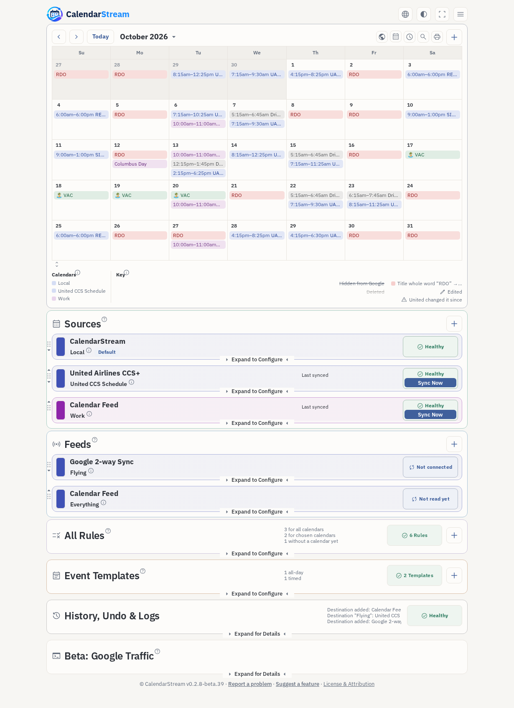
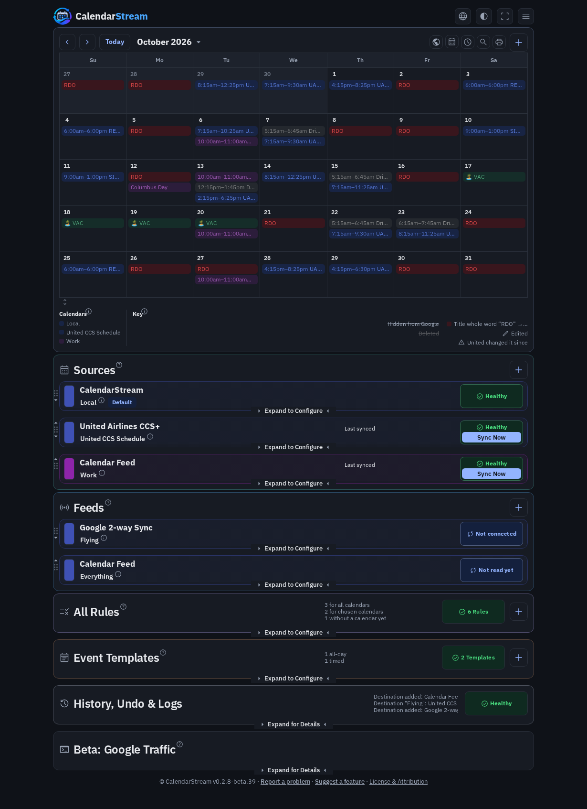
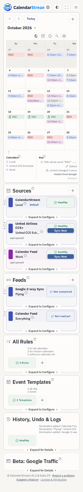
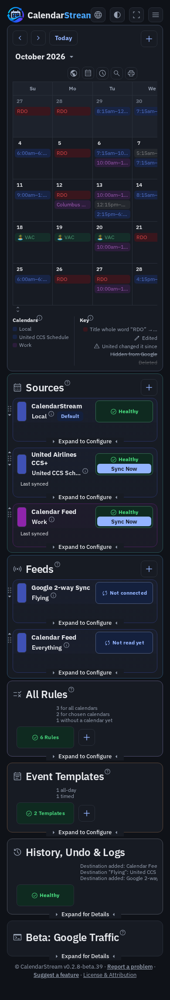

# CalendarStream — proposed theme cleanup

Real rendered mockups from synthetic demo data. Source: `de0ce9ba6054d6912366ec691721968cb63dee83`; baseline: main at `b60b4fc`.
These assets are on `review-files`, outside the application PR, and do not ship in the app image.

**[Download the interactive before/after mockup ZIP](CalendarStream-theme-preview.zip?raw=1)**, extract it, and open `CalendarStream-theme-preview.html` in a browser.

[HTML file only](CalendarStream-theme-preview.html?raw=1) is also available.
It includes desktop/phone, Light/Dark, a before/after toggle, and PNG downloads. No server or account is needed.

The intentional changes are 14px default text, 13px notes, darker Light secondary text meeting 4.5:1 on the three base surfaces,
34px general icon buttons, 5px calendar-key spacing, and 12px anchored-menu padding/corners. Calendar controls remain compact,
the accent/status colors are retained, and print-preview rendering is unchanged.

## Desktop — after

## Phone — after

## More states

[Expanded modules — Light](expanded-light.png) · [Dark](expanded-dark.png)

[View menu — Light](view-menu-light.png) · [Dark](view-menu-dark.png)

## Before

[Desktop Light](before-1230-light.png) · [Desktop Dark](before-1230-dark.png) ·
[Phone Light](before-390-light.png) · [Phone Dark](before-390-dark.png)

Validation covers 64 before/after captures, plus the theme/browser suites. This is a first component consolidation,
not a claim that all historical CSS is migrated or that browser performance is improved.
